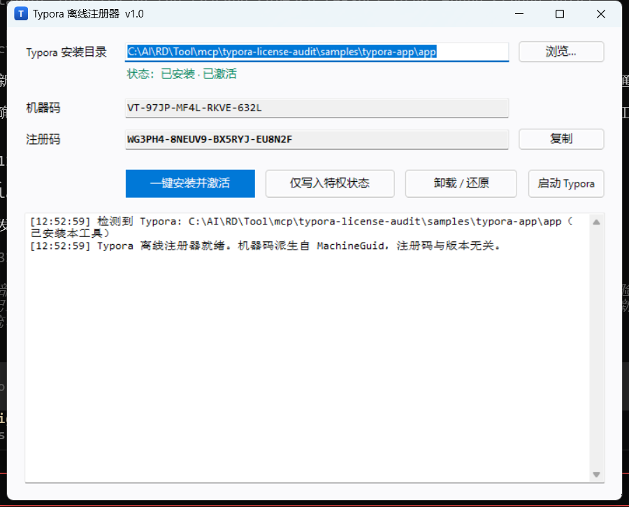
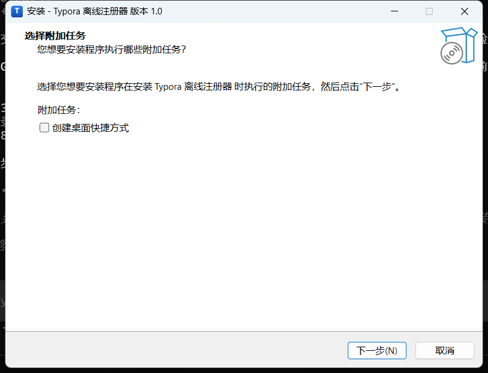

<div align="center">
  

  <h1>Typora_Mod</h1>

  <p>
    <strong>Typora 离线授权状态研究工具</strong><br>
    让 Typora 自己的许可面板显示「已激活」—— 零厂商文件修改 · 可逆 · 抗升级
  </p>

  <p>
    <a href="LICENSE"></a>
    
    
    
    <a href="https://github.com/Angel-Gril/Typora_Mod/actions/workflows/build.yml"></a>
  </p>

  <p>
    <a href="dist/TyporaSetup.exe"><strong>下载</strong></a> ·
    <a href="#功能特性">功能特性</a> ·
    <a href="#快速开始">快速开始</a> ·
    <a href="#版本支持">版本支持</a> ·
    <a href="#工作原理">工作原理</a> ·
    <a href="#常见问题">常见问题</a> ·
    <a href="#社区交流">社区交流</a>
  </p>
</div>

---

> 仅用于安全研究与已授权测试环境。详见 [LICENSE](LICENSE)。

## 📖 简介

Typora_Mod 是一套面向 **Windows x64 / Typora** 的授权状态研究工具，用于验证一个问题：

> 当授权判定完全发生在客户端本地时，防御的边界到底在哪里？

它不改动厂商任何文件，而是通过**同目录原生代理 + 运行时旁路资源**，
让 Typora 自己加载到我们改写过的状态，最终由 **Typora 自己的 React 许可页**
渲染出「Typora 已激活」—— 不是遮罩，也不是自绘界面。

## ✨ 功能特性

| 能力 | 说明 |
|---|---|
| 🎫 **机器码 / 注册码** | 由本机 `MachineGuid` 派生，跨版本稳定；离线生成与校验 |
| 🧩 **原生许可页** | 由 Typora 自身页面渲染 `stage-0` 激活视图，按钮/主题/语言全部原生 |
| 🚫 **角标消除** | 接管主进程下发的未注册注入脚本，主窗口不再出现「未激活 ×」 |
| 🔇 **静默启动** | 启动时许可窗从未以不透明状态出现（40 ms 粒度采样 0 命中） |
| 🔁 **抗版本升级** | 原生层每次启动比对 `app.asar` 指纹，变化即自动重建旁路资源包 |
| 🧯 **可逆** | 一键卸载，移除全部部署物与状态；厂商 `app.asar` 始终保持原始字节 |
| 🌐 **全离线** | 不联网、不写伪造许可、不修改注册表许可项 |
| 🔍 **版本自检** | 自动识别 Typora 结构代次，不支持时明确提示而非静默失败 |

## 📸 界面

<div align="center">

**注册器主界面** · 自动识别安装目录、版本与布局



<br><br>

**Typora 原生许可面板** —— 由应用自己的 React 页面渲染




</div>

<a id="快速开始"></a>

## 🚀 快速开始

### 绿色版（推荐）

1. 下载 [`dist/TyporaSetup.exe`](dist/TyporaSetup.exe)（单文件，无需安装）
2. 双击运行 → 确认自动识别的 Typora 目录（不对就点「浏览…」）
3. 点 **「一键安装并激活」** → 重启 Typora

> 小技巧：把 `TyporaSetup.exe` 放进 Typora 安装目录，它会自动填好路径。

### 安装版

下载 [`dist/TyporaVirt-Setup-1.0.exe`](dist/TyporaVirt-Setup-1.0.exe) → 中文向导一路下一步
（安装到 `%LOCALAPPDATA%\Programs\TyporaVirt`，带开始菜单与系统卸载项，无需管理员权限）。

### 命令行

```powershell
# 生成机器码 / 注册码
powershell -ExecutionPolicy Bypass -File tools\typora-keygen.ps1

# 直接写入激活状态（跳过图形界面）
powershell -ExecutionPolicy Bypass -File tools\typora-keygen.ps1 -WriteState

# 安装 / 卸载 / 状态 / 验收
powershell -ExecutionPolicy Bypass -File tools\install-typora-virt.ps1 -Action install
powershell -ExecutionPolicy Bypass -File tools\install-typora-virt.ps1 -Action uninstall
powershell -ExecutionPolicy Bypass -File tools\verify-typora-virt.ps1
```

### 卸载

图形界面点 **「卸载 / 还原」**，或系统「应用和功能」中卸载（安装版会自动还原补丁）。

<a id="版本支持"></a>

## 🧭 版本支持

| Typora 版本 | 支持 | 主进程结构 |
|---|---|---|
| **1.10.8 ～ 1.14.10** | ✅ 完整支持 | `launch.dist.js` + `atom.compiled.dist.jsc` |
| ≤ 1.9.5（1.7.6 / 1.8.10 / 1.9.5） | ❌ 不支持 | 原生 `main.node` + 加密 `atom.js`，无 JS 注入点 |

工具会自动检测并提示，不会在旧版上静默失败：

```
状态：未安装 | 检测到 Typora v1.14.10 · 布局支持
状态：未安装 | 检测到 Typora v1.9.5   · 布局不支持（需 1.10+）
```

<a id="工作原理"></a>

## ⚙️ 工作原理

```
Typora.exe ──加载──▶ winmm.dll（同目录同名代理，系统 DLL 也用它）
                       │
                       ├─ 读 virt.cfg → 定位运行时模块
                       ├─ 比对 resources\app.asar 指纹
                       │    └─ 变化 → 重建 app.virt.asar（注入 loader 引导）
                       └─ IAT 钩子：打开 app.asar → 改开 app.virt.asar
                              │
                              ▼
                        virt-loader.js
                          ├─ 校验本机注册状态（MachineGuid 派生）
                          ├─ 改写许可页 URL 状态（ecp / hasActivated / email / license）
                          ├─ 替换应用下发的「未注册」注入脚本 →「已激活」
                          ├─ 许可窗生命周期（启动静默，用户主动打开才显示）
                          └─ 退出守卫（仅拦截「许可超时」触发的自动退出）
```

厂商 `app.asar` 全程只读；所有改动发生在**旁路文件**与**自有状态文件**中：

| 路径 | 作用 |
|---|---|
| `<Typora>\winmm.dll` | 原生代理（导出转发 180 项 + IAT 钩子） |
| `<Typora>\winmm_real.dll` | 系统原件副本（转发目标） |
| `<Typora>\virt.cfg` | 指向运行时模块 |
| `<Typora>\resources\app.virt.asar` | 自动生成的旁路资源包 |
| `%LOCALAPPDATA%\TyporaVirt\` | JS 运行时模块 |
| `%APPDATA%\Typora\virt-reg.json` | 本机注册状态 |

<a id="项目结构"></a>

## 📁 项目结构

```
build/winmm/          原生代理 DLL（Rust）
  src/lib.rs            导出转发跳板（180 个导出）
  src/hook.rs           asar 解析/重建、IAT 钩子、指纹校验
build/gui/            图形界面（C# WinForms）+ Inno Setup 脚本 + 图标
patches/              JS 运行时模块
  virt-loader.js        引导：注册检查 / 虚拟化 / 退出守卫
  registration.js       机器码↔注册码算法 + 状态持久化
  license-virtualize.js 许可页状态与窗口生命周期
  license-forge.js      [实验] 密码学边界接管
  jsc-patch.js          [实验] V8 字节码等长补丁框架
  state-hunt.js         [实验] 主进程状态定位
tools/                PowerShell / Node 辅助脚本与取证工具
dist/                 构建产物（绿色版 / 安装版 / 使用说明）
docs/
  images/             截图与徽章
  reports/            技术报告（审计链还原、实现演进、版本兼容）
```

<a id="构建"></a>

## 🛠️ 构建

需要：Rust（stable）、.NET Framework 4 自带 `csc.exe`、Inno Setup 6（可选）、Node.js 18+（可选）。

```powershell
# 1) 原生代理
cd build\winmm
cargo build --release                      # -> target\release\winmm.dll

# 2) 图形界面（内嵌 DLL 与运行时模块）
#    完整命令见 CONTRIBUTING.md

# 3) 安装包（可选）
ISCC.exe build\gui\installer.iss
```

<a id="技术报告"></a>

## 📚 技术报告

| 文档 | 内容 |
|---|---|
| [`docs/reports/AUDIT-REPORT.md`](docs/reports/AUDIT-REPORT.md) | 授权链完整还原：机器码算法、RSA-2048 公钥、令牌结构 |
| [`docs/reports/TOOL-v8-native-panel.md`](docs/reports/TOOL-v8-native-panel.md) | 许可页状态机还原（`ecp` 算术编码、`stage` 索引） |
| [`docs/reports/TOOL-v10-native-fully.md`](docs/reports/TOOL-v10-native-fully.md) | 主窗口「未激活」角标的原生消除 |
| [`docs/reports/TOOL-v12-version-compat.md`](docs/reports/TOOL-v12-version-compat.md) | 版本兼容性实测 + 启动闪现根治 |

<a id="常见问题"></a>

## ❓ 常见问题

<details>
<summary><b>升级 Typora 后需要重新弄吗？</b></summary>

不需要。`winmm.dll` 每次启动都会比对 `app.asar` 指纹，变化即自动重建旁路资源包；
注册码由 `MachineGuid` 派生，与版本无关。
</details>

<details>
<summary><b>会不会写注册表 / 伪造许可？</b></summary>

不会写任何伪造许可。唯一写入的是自有状态文件 `%APPDATA%\Typora\virt-reg.json`。
</details>

<details>
<summary><b>需要联网吗？</b></summary>

完全离线，无任何网络请求。
</details>

<details>
<summary><b>杀毒软件报警？</b></summary>

`winmm.dll` 的行为特征（代理系统 DLL + 读取同目录资源）与部分注入类程序相似，可能被启发式误报。
源码在 `build/winmm/`，可自行编译核对。
</details>

<details>
<summary><b>许可页显示的是真的吗？</b></summary>

显示内容由 Typora 自己的 React 页面渲染（`page stage-0`），
我们提供的是状态参数（`ecp` 编码 + 邮箱 / 序列号），不是自绘遮罩。
</details>

<a id="能力边界"></a>

## 🧱 能力边界

1. **呈现层是原生的，数据层是虚拟化的** —— Typora 自己的页面在渲染，但驱动它的状态来自本工具。
2. 应用内部的 `hasLicense` 布尔值仍由启动校验决定；伪造令牌会在启动时被清空，
   因此本项目不写伪造许可、不碰注册表许可项。
3. RSA-2048 签名 + 机器绑定在数学上不可本地伪造 ——
   本项目证明的是「客户端本地鉴权不足以单独作为授权依据」，这正是 CWE-602 的核心。

<a id="免责声明"></a>

## ⚖️ 免责声明

软件按「原样」提供，不附带任何担保。

<a id="社区交流"></a>

## 💬 社区交流

本开源项目已链接并认可 [LINUX DO 社区](https://linux.do/)。

[](https://linux.do/)

LINUX DO — 新的理想型社区。
